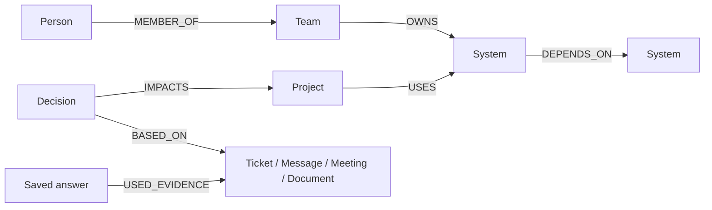

# ContextMind

[](#railway-deployment)
[](LICENSE)

**Good questions. Connected answers.** ContextMind is an evidence-first prototype for the **Company Brain** track. It connects a **fictional** fintech company's people, teams, projects, systems, tickets, chats and decisions in a typed graph. Ask what breaks when a service fails, who owns it, or why a migration was delayed; inspect the stored relationships and sources behind each bounded answer. The separate public workspace is a captured GitHub snapshot, **not a live feed**. This repository uses **complete local setup**, not a verified live deployment.

## New: FalkorDB public-data workspace

Use the dashboard workspace selector to switch between **NovaPay (fictional sandbox)** and **FalkorDB (real public GitHub snapshot)**. Open `/dashboard?workspace=falkordb` or `/demo.html?workspace=falkordb` for the builder walkthrough.

The committed snapshot contains **149 public repositories**, with bounded docs, README, release, issue/PR, and contributor samples for ten repositories: **332 nodes and 378 provenance-bearing edges**. All source URLs are real; docs/README citations are commit-pinned. No example versions, fabricated rationale, or maintenance inferred from commit counts were seeded.

Try Python getting-started, LangChain integration, public contributor evidence, or recent release notes. Unsupported financial, private-roadmap, rationale, and compatibility questions explicitly report missing evidence. This is a **snapshot**, not a live feed; backend storage mode is separately labeled.

**[Full scope, collection/replay commands, privacy removal, freshness, and limitations →](docs/falkordb-public-data.md)**

### Show FalkorDB in the presentation

The [downloadable 2:20 Company Brain video](presentation/ContextMind-FalkorDB-demo.mp4) starts with **fictional NovaPay**: a decision traced to ticket/chat/meeting/RFC evidence, recorded tool calls, ownership, a bounded shortest-evidence-path search, answer memory after reload, and a token-protected fictional ticket update that changes the next answer. It then switches to the **real public FalkorDB GitHub snapshot** for a contributor question and release-source evidence. Both workspaces show different fixed, parameterized **native Cypher proofs**; JSON preview says **CYPHER NOT EXECUTED**. No public human maintainer or public organizational decision is invented. See the [presenter runbook](docs/presenter-runbook.md) for recording steps and cautions, and an [unpublished story draft](docs/company-brain-story.md) for a short write-up. The MP4 includes user-selected Indian English narration and captions; raw footage and voice clips remain ignored under `deliverables/`. No cloud deployment or live feed is claimed.

```sh
python -m connectors.collect --org falkordb --source github  # optional, real API capture
python data/seed.py --org falkordb                           # offline snapshot replay
```

The website, partner sites, YouTube, Discussions, and Discord are **not collected**. No ten-decision or full integration-coverage claim is made. Maintainer outreach is a [draft only](docs/maintainer-outreach.md).

## Demo and submission status

- **Quick-test guide:** [`/demo.html`](frontend/demo.html), served by the running app; append `?workspace=falkordb` for the public walkthrough.
- **Dashboard:** `/dashboard` (also available at `/`).
- **Health:** `/api/health` checks that the graph can read the seeded Database Cluster. Returns HTTP 200 with `status: healthy`, `version: 1.0.0-mvp`, actual `graph_mode`, and `sample_data: NovaPay`; HTTP 503 if the graph read fails. Existing `backend` and `company` fields remain compatible with the dashboard.
- **Repository:** [rihanstranger09/ContextMind](https://github.com/rihanstranger09/ContextMind), verified public.
- **License:** [MIT](LICENSE).
- **Public deployment:** not yet provisioned or verified. The badge above indicates configuration readiness, **not** a successful deployment. No placeholder URL is presented as live.

The dashboard’s **Demo guide** link opens instructions for testing chat, graph interactions, source cards, and evidence traces. The guide shows the current host URL, probes health, and links all five demo questions into the dashboard input. Questions are not sent until the user submits them.

## Railway deployment

1. In Railway, create a project from this GitHub repository. Deploy `main` after merging the cloud-connection PR, or select **`arena/bac5286a-contextmind`** to test it before merge.
2. Railway can use the included `Dockerfile` and `railway.json`. The container listens on `0.0.0.0:$PORT` (8000 locally); `/api/health` is the deployment health check.
3. For a quick **fictional-data-only** demo, set `GRAPH_BACKEND=demo`. Leave `INGEST_TOKEN` unset to disable ingestion. Keep one instance/worker. Without a persistent volume, runtime demo updates and answer traces are lost on redeployment; for persistence, mount a volume at `/app/.runtime`.
4. For FalkorDB mode, provision a reachable FalkorDB service separately and set `GRAPH_BACKEND=falkordb`, `FALKOR_HOST`, `FALKOR_PORT`, `FALKOR_USERNAME`, `FALKOR_PASSWORD`, `FALKOR_SSL=true`, and a dedicated `FALKOR_GRAPH` in Railway **secret variables** (or use `FALKOR_URL=rediss://...` instead of the individual connection settings). Railway does not deploy the local Compose stack automatically. Use the provider's Redis-protocol endpoint, not its web console URL; TLS certificate and hostname verification stay enabled. See [cloud connection setup](#cloud-falkordb-connection).
5. Generate a public domain in Railway’s networking settings. Open `/demo.html`, confirm health, and submit each suggested question. Check chat facts, graph nodes, source excerpts, and the expandable trace.
6. Add the **real, verified URL** to this README, and only then change the badge to “Deployed on Railway” linked to that URL.

Public hosting may incur charges. This prototype has no authentication or rate limits, and answering questions persists traces. Use only the fictional dataset and limit public demo exposure; do not treat the demo as production-ready.

### Final submission checklist

- [x] Implementation pushed to GitHub on `arena/bac5286a-contextmind` (pull request #2 is open).
- [ ] Merge this PR or select this branch for a Railway deployment; deployment has not been verified.
- [ ] Deploy the app and test the public URL (including `/demo.html` and `/api/health`).
- [ ] Add the verified public deployment link to this README and update the badge.
- [x] Demo instructions visible from the dashboard.
- [x] Automated API coverage for all five suggested questions, graphs, sources, and traces.
- [ ] Manually verify those workflows in a browser on the public deployment.
- [x] Health endpoint reports readiness and actual graph mode.
- [x] Repository visibility verified public.
- [x] MIT license included.

## Quick start

### FalkorDB deployment (local, not public hosting)

On a clean machine install Git, Docker Engine/Desktop with Compose, and a browser. Clone this **public** repository and run from its root:

```sh
git clone https://github.com/rihanstranger09/ContextMind.git
cd ContextMind
# If the Company Brain changes are still in an open PR, use its fixed branch:
git checkout arena/bac5286a-contextmind
docker compose up --build
```

No credential is required for the local isolated database; leave operator ingestion disabled. The app automatically seeds the **fictional NovaPay** graph and the separate bounded public snapshot when their graphs are empty. Check `http://localhost:8000/api/health` and `http://localhost:8000/api/health?workspace=falkordb`: both should report `graph_mode: falkordb`. Open both graph-proof dialogs: they must report `native_cypher_executed: true` before claiming native execution. To re-seed for filming, use `scripts/seed_demo_graph.py` with an isolated graph prefix as explained in the recording runbook; never reset a production graph.

Open **http://localhost:8000**. Compose starts FalkorDB, waits for its health check, and starts the API and frontend. Operator writes are disabled unless you explicitly set a private `INGEST_TOKEN` in the shell. The initial graph is automatically seeded on first startup. FalkorDB data is stored in a named volume; its database port is mapped **only to host loopback `127.0.0.1:6380`** for local seed/check tooling and is not published on a public interface. If that port is occupied, change the host-side port and the seed command accordingly.

The graph indicator in the sidebar reports the actual backend. FalkorDB failures do **not** silently fall back to demo storage.

### Local preview without Docker

Python 3.11+:

```sh
python -m venv .venv
source .venv/bin/activate
pip install -r requirements.txt
pytest -q                            # offline suite; native integration test skips without a database
GRAPH_BACKEND=demo uvicorn app.main:app --host 0.0.0.0 --port 8000
```

Demo mode is explicitly labeled **JSON storage / CYPHER NOT EXECUTED**. It uses the same bounded tools with a local JSON adapter, persists updates and traces to ignored `.runtime/demo.json`, and needs no credentials or external services. Delete that file to reset *only this local preview*; do not confuse it with a native graph proof. The `.env.example` documents configuration. To configure an existing **native** database from a shell, copy it to ignored `.env.txt`, set only your own connection values locally, then load with `set -a; . ./.env.txt; set +a`; the app never automatically loads that file. Do not commit it. Run `npm ci --prefix tests/browser`, then `BASE_URL=http://127.0.0.1:8000 CHROMIUM_BUNDLED_LIBS=1 npm test --prefix tests/browser` for the optional browser checklist.

To connect locally to an existing FalkorDB instance, set `GRAPH_BACKEND=falkordb`, `FALKOR_HOST`, `FALKOR_PORT`, and optionally `FALKOR_GRAPH` (default `contextmind`).

### Cloud FalkorDB connection

Use the cloud provider's **Redis-protocol host and port**. Configure either individual variables:

```sh
GRAPH_BACKEND=falkordb
FALKOR_HOST=your-redis-endpoint.example
FALKOR_PORT=6379
FALKOR_USERNAME=default
FALKOR_PASSWORD=                     # set privately, never in a committed file
FALKOR_SSL=true
FALKOR_GRAPH=contextmind_cloud
```

Or set `GRAPH_BACKEND=falkordb`, a dedicated `FALKOR_GRAPH`, and **only** `FALKOR_URL` to the provider-supplied TLS URI in ignored local environment or secret variables. URL-encode special characters in URI credentials without printing the URI. `rediss://` enables TLS; certificate verification and hostname verification are required. If the provider uses a private CA, set `FALKOR_CA_CERTS` to a mounted PEM CA file (do not disable TLS verification). Passwordless `redis://` and `FALKOR_SSL=false` are for trusted private/local networks only. Both workspaces are stored in separate graph names: `FALKOR_GRAPH` (fictional NovaPay) and `FALKOR_GRAPH_public_falkordb` (public snapshot). **Startup automatically seeds empty graphs**; choose a fresh dedicated graph prefix and ensure the account permits graph writes. The chat API also persists answer traces. Do not connect this unauthenticated prototype to sensitive production graphs or expose it publicly without access controls.

For local testing, place shell-compatible assignments in an ignored `.env.txt`, then load them into the shell before starting the app:

```sh
set -a; . ./.env.txt; set +a
uvicorn app.main:app --host 0.0.0.0 --port 8000
# Check both workspaces:
curl http://localhost:8000/api/health
curl 'http://localhost:8000/api/health?workspace=falkordb'
```

Quote values containing shell metacharacters in `.env.txt`. The app does **not** auto-load env files. `.env.txt` and `.env` are excluded from Git and Docker builds; never add secrets to a PR, logs, or `.env.example`. In Railway, configure secret variables instead of uploading `.env.txt`. If the service is unreachable, startup fails instead of silently falling back to demo data.

## Demo in two minutes

1. Ask **“What is at risk if the Database Cluster is unavailable, who should respond, and what previous decisions are relevant?”**
2. Inspect the multi-hop project dependencies and scored experts. Click **Path** beside a claim to see its stored relationships.
3. Open a source card to read its excerpt and timestamp. All `novapay.example` source URLs are deliberately fictional and shown as text, not working external links.
4. Ask **“Why was Analytics Migration delayed?”** to follow the decision to DB-212, chat, planning notes, and the RFC.
5. Ask **“Which critical systems have no active owner?”** to find missing Redis ownership/documentation.
6. Use the source library, click graph nodes, change graph focus, and zoom. `Ctrl / Cmd K` focuses the question input.

More supported questions:

- Who owns API Gateway?
- Who knows the most about Payment Service?
- What is the shortest path from Alice Johnson to Database Cluster?
- What tickets block the Q4 launch?
- Find docs about Database Cluster.

Entity IDs are stable and discoverable at `/api/entities`; for example the database is `sys_database` and the migration decision is `decision_delay`.

## Graph data model and architecture

The fictional Company Brain stores typed nodes `Person`, `Team`, `System`, `Project`, `Ticket`, `Message`, `Meeting`, `Document`, `Decision`, `Incident` and saved `AgentDecision` investigations. The public snapshot uses separate `Organization`, `Repository`, `Version`, `Guide`, `Person`, `Ticket` and integration records. Both graphs use real directed, typed relationships, not inferred links from a visualization.



**[Graph data model, all native Cypher queries and traversal algorithms →](docs/graph-model-and-queries.md)** · **[Submission checklist, setup, AI assistance and eligibility →](docs/submission-checklist.md)**. The selected track is **Company Brain**. The graph is the operational store in native mode, not merely the SVG view.

```text
Question (same-origin dashboard/API)
    → deterministic entity/intent router (no LLM)
    → allowlisted bounded graph tools (impact, ownership, decision, shortest path)
    → FalkorDB parameterized adjacency reads + fixed Cypher proofs
    → cited answer + persisted AgentDecision / USED_EVIDENCE trace
```

The [architecture card](frontend/architecture.html) depicts this executed path. **Why the graph is essential:** ownership needs `LEADS`/`OWNS`; impact and shortest-path need ordered multi-hop `USES`, `DEPENDS_ON` and `WORKED_ON`; decision provenance requires `BASED_ON` and `IMPACTS`; memory links saved answers to evidence. Without those stored nodes/relationships, the supported answers lose their inspectable paths, and without native FalkorDB the two executable Cypher proofs and graph-backed persistence are unavailable. The JSON adapter is an explicitly labeled offline preview with the same *seeded relationships*, not evidence of native execution.


- **`graph/store.py`**: parameterized FalkorDB storage plus an explicit JSON demo adapter. Entities have `:Entity` and their domain label (`:System`, `:Person`, etc.). Edges use native domain relationship types (`DEPENDS_ON`, `USES`, etc.). Node payloads preserve source metadata; `id`, `name`, `updated_at`, and `kind` are also directly queryable properties.
- **`graph/tools.py`**: entity resolution, direct/team-lead ownership, expert ranking, reverse dependency traversal, **bounded shortest-evidence-path BFS**, decision evidence, blockers, knowledge gaps, and evidence retrieval. Impact analysis includes directly used systems and indirect dependencies up to five hops, with cycle protection. Visualization neighborhoods are capped at 70 nodes and depth 3.
- **`agents/public_brain.py`**: conservative public-workspace retrieval, source excerpts, artifact/activity queries, and missing-evidence controls. No personal rankings.
- **`connectors/`**: bounded public GitHub capture, offline-ready snapshot, explicit full-refresh watcher, and snapshot Person removal.
- **`agents/company_brain.py`**: routes supported questions, assembles only relevant facts/evidence, exposes auditable retrieval paths, and stores the answer trace. Unknown entities produce an explicit insufficient-context response.
- **`app/main.py`**: validated HTTP API, write token checks, static frontend.
- **`data/sample_company.json`**: fictional NovaPay company graph; regenerate with `python data/generate.py`.

**No LLM is wired in yet.** Answer synthesis is deterministic and supported intents are keyword-based. The Tools used panel shows actual rule-selected graph tools, not an autonomous planner. AI coding assistants helped build and test this repository and generate the demonstration narration; see [AI disclosure and eligibility checklist](docs/submission-checklist.md). The frontend shows evidence paths, not hidden chain-of-thought. This makes the demo reproducible and avoids fabricated company facts. The tools operate through FalkorDB reads in database mode; the graph is not merely a visualization layer. An LLM integration should receive only these bounded facts, excerpts, and paths, never the entire graph or permission to execute arbitrary Cypher.

### Expertise scoring

Recorded direct/project work = 3; document authorship = 2; resolved incident = 4; direct ownership or owning-team lead = 5. Unique evidence paths contribute once; multiple distinct dependency paths may contribute. Scores are explanatory heuristics, **not probabilities**. Recorded availability/on-call status is displayed but must be confirmed before escalation. Recency weighting is not yet implemented.

## API

Interactive OpenAPI documentation: **`/docs`**.

| Method | Endpoint | Purpose |
|---|---|---|
| GET | `/api/health` | Backend and demo-data status |
| GET | `/api/entities?q=&type=` | Entity search (bounded to 100) |
| GET | `/api/entities/{id}` | Entity or saved answer trace |
| POST | `/api/chat` | `{ "question": "Who owns API Gateway?" }` |
| POST | `/api/impact` | `{ "system_id": "sys_database" }` |
| GET | `/api/experts/{id}` | Ranked experts with paths |
| GET | `/api/decisions/{id}/trace` | Decision relationships |
| GET | `/api/investigations?workspace=novapay` | Bounded saved answer/tool-trace memory (fictional workspace) |
| GET | `/api/graph/showcase?workspace=falkordb` | Fixed public proof; Cypher executes only in native mode |
| GET | `/api/graph/company-proof?workspace=novapay` | Fixed fictional decision proof; Cypher executes only in native mode |
| GET | `/api/graph/subgraph?entity_id=sys_database&depth=2` | Bounded graph neighborhood |
| GET | `/api/risks` | Critical systems missing ownership/docs |
| POST | `/api/ingest/documents`, `/tickets`, `/messages` | Token-protected source upsert |

### Fictional operator update

Writes are **disabled by default**. In a disposable local instance, set a private `INGEST_TOKEN` in your shell or Compose environment before launching the app. The ingestion API requires that private operator credential but the dashboard never displays it. See [`scripts/record_runbook.md`](scripts/record_runbook.md) for a guarded recording sequence that reads a real successful API response, shows only allowlisted receipt fields, and stops if a write fails. No production authentication or access controls are provided.

The fictional ticket's normalized status is read from the graph on every re-ask. Resolved tickets disappear from *active* blockers while historical answer snapshots stay in memory. Writes reject stale updates and unsupported relationship changes; there is no push sync or background company connector.

## Verification

```sh
pytest -q
node --check frontend/app.js
```

Tests additionally cover the 25-question public-data evaluation set, provenance integrity, workspace isolation, replay idempotency, and Person suppression. Original tests cover alias resolution, direct/multi-hop impact, indirect expertise, citations/decision traces, missing context, gaps, idempotent persistence, blocker resolution, and API/write validation. Offline tests use the JSON adapter. An opt-in native FalkorDB integration test and CI service job are provided; their results must be verified separately from local offline tests.

## Scope and limitations

This is a runnable hackathon foundation, **not a production knowledge/security platform**:

- Slack/Jira/Notion connectors are not implemented. The FalkorDB public workspace has a bounded GitHub snapshot connector and opt-in full refresh, not comprehensive incremental synchronization. NovaPay ingestion accepts normalized manual records.
- No authentication, per-user ACLs, tenant isolation, rate limits, or audit retention policy. `user_id` is not an authorization boundary. Use only fictional/sanitized data.
- Entity matching uses IDs/names/aliases, not vector search or an ambiguity-confirmation dialogue. The public workspace retrieves attributed excerpts using deterministic term matches; it does not establish all organizational meaning from arbitrary questions.
- Missing-owner detection reflects absence of recorded ownership, not a verified lack of a real-world owner. No employee-active-state checks yet.
- Source cards mark records older than 90 days. Staleness does not automatically invalidate a source. No stale-doc risk scoring yet.
- Expert scores do not model current workload or recent activity. No automated paging or work assignment.
- Graph tools issue parameterized adjacency queries and traverse in Python. Two fixed native Cypher proofs and a bounded BFS shortest-path tool over those reads are available; no native graph-algorithm library or PageRank is claimed. This MVP is not optimized for large graphs; entity search is bounded to 100 results for NovaPay / 2,000 for the public workspace, adjacency reads to 500, and trace pagination is not implemented.
- Cross-record FalkorDB writes are not transactional; concurrent ingestion conflict control and migrations remain future work. Run one API worker for the JSON demo backend.
- The UI is an interactive SVG explorer with focus and zoom, not a force-directed editor. Operator ingestion uses an authenticated API; no public write control is exposed. A downloadable narrated demo video is included, but it shows local native storage, not a verified hosted deployment.

**FalkorDB is the company graph, evidence store, and answer-trace memory in database mode. Every supported factual answer is built from graph relationships that can be inspected.**

### Browser checklist

A repeatable Playwright/Chromium suite covers the dashboard in both workspaces, workspace switching, typed queries, Send/Enter, graph rendering, sources/traces, every demo question, mobile layout interaction, and console/network failures. See the [run instructions](tests/browser/README.md) and [verified checklist and scope](docs/testing-checklist.md). Browser artifacts remain in ignored `.runtime/browser-results/`.

## Provenance and build timeline

This repository began as an earlier prototype; the current branch adds cloud-connection support, public-snapshot proofs, Company Brain evidence/memory, bounded traversals, and recording assets on top of that pre-existing core. The Git commit history remains intact and is the authoritative build timeline. Later work and a new recording do **not** make earlier implementation retroactively eligible for any event. Confirm eligibility with the organizers before submitting; no claim of a verified cloud deployment or completed submission is made.

## AI assistance disclosure

AI coding assistants in **Arena.ai Agent Mode** helped implement and test code, review documentation, draft video scripts and generate the earlier AI-narrated demonstration. The product itself has **no LLM wired in**: question routing and synthesis are deterministic. The human author must personally review this code, graph model, Cypher, architecture and output, and be able to explain them before declaring that review complete in the submission form. Human review and event eligibility have **not** been independently verified here; do not claim otherwise.

## Submission media status

The [existing downloadable video](presentation/ContextMind-FalkorDB-demo.mp4) is a local-native **v3 fallback**, not the shorter [v4 storyboard](docs/company-brain-v4-script.md). The v4 [draft captions](presentation/ContextMind-v4-draft.srt) are script-derived, **not** synchronized to a new narration or attached to the current MP4. Do not submit them as a finished v4 video. [Exact recording/runbook and video description](scripts/record_runbook.md) explain the remaining native proof and media checks. The repository supplies complete **local setup** instead of a verified hosted URL.
