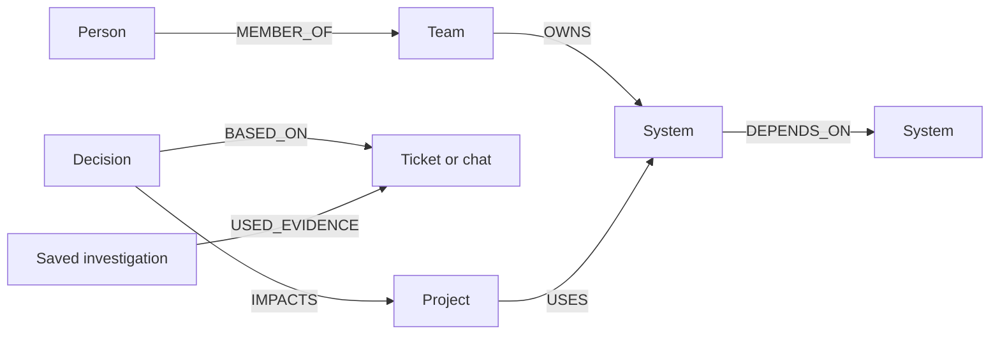

# Graph data model, queries and tool-routing algorithms

**Track: Company Brain.** ContextMind has two physically separate graph names: `${FALKOR_GRAPH}` contains **fictional NovaPay company data**; `${FALKOR_GRAPH}_public_falkordb` contains a **bounded, timestamped public GitHub snapshot**. No private corporate data is claimed. `GRAPH_BACKEND=demo` uses JSON for preview; `GRAPH_BACKEND=falkordb` executes the following against native FalkorDB. Both adapters return the same domain records.

## Nodes and edges

Every domain node is `(:Entity:<DomainLabel> {id, kind, name, updated_at, search, payload})`. The JSON `payload` preserves the complete record and metadata. `:Entity(id)` is indexed. NovaPay nodes include `Person`, `Team`, `Project`, `System`, `Document`, `Ticket`, `Message`, `Meeting`, `Decision`, `Incident`, and `AgentDecision`. Public nodes include `Organization`, `Repository`, `Version`, `Guide`, `Integration`, `Document`, `Ticket`, `Person`, and `Skill`. AgentDecision means a saved *answer/investigation*, not an inferred organizational decision.

```text
NovaPay (fictional):
Person --MEMBER_OF--> Team --OWNS--> System <--ABOUT-- Document / Ticket
Person --OWNS / WORKED_ON--> System / Project
System --DEPENDS_ON--> System <--USES-- Project
Ticket --BLOCKS--> Project <--IMPACTS-- Decision
Decision --BASED_ON--> Ticket / Message / Meeting / Document
AgentDecision --USED_EVIDENCE--> source nodes

FalkorDB public snapshot (real public artifacts, not a company HR graph):
Organization --OWNS--> Repository --VERSION--> Version
Person --CONTRIBUTES_TO--> Repository <--ABOUT-- Guide / Document
Ticket --IN_REPO--> Repository; Guide --DOCUMENTS--> Integration / Skill
```

The UI's **GRAPH MODEL** dialog renders this compact node-and-edge diagram; the wider textual list above is the complete domain schema:



The `BASED_ON` edge is directed **Decision → source**. The full graph also links Meeting/Document evidence and other domain types listed above.

Links and source cards in the public workspace carry provenance (GitHub URL, capture time, hash, inferred flag). Hashes check stored snapshot integrity, **not external truth**. Public contributions are not proof of maintainer status. NovaPay's `novapay.example` URLs are fictional.

## Native FalkorDB queries (fixed and parameterized)

The presentation shows **two** read-only Cypher traversals:

```cypher
MATCH (org:Entity {id: $org})-[:OWNS]->(repo:Entity {id: $repo})-[:VERSION]->(release:Entity)
RETURN org.id, repo.id, release.id
ORDER BY release.name DESC LIMIT 3
```

The public proof uses stable snapshot IDs for the FalkorDB organization and Python client repository. The order is lexical on stored names; do not claim semantic-version sorting or a live release feed. See `graph/showcase.py` and `/api/graph/showcase?workspace=falkordb`.

```cypher
MATCH (decision:Entity {id: $decision})-[:BASED_ON]->(source:Entity),
      (decision)-[:IMPACTS]->(project:Entity {id: $project})
RETURN decision.id, source.id, project.id
ORDER BY source.id LIMIT 4
```

The NovaPay proof links its seeded migration delay to ticket, chat, meeting, documentation and impacted project. It is *fictional*, not a FalkorDB company decision. See `/api/graph/company-proof?workspace=novapay`. Both proof endpoints reject the other workspace and do not accept user-supplied Cypher, IDs, or graph names. They mark JSON previews **CYPHER NOT EXECUTED**.

Production retrieval uses **additional** parameterized native queries in `graph/store.py` (the graph is not merely a visualization):

```cypher
MATCH (n:Entity {id:$id}) RETURN n.payload
MATCH (n:Entity) WHERE n.kind <> "AgentDecision" AND ($kind = "" OR n.kind = $kind) AND n.search CONTAINS $text RETURN n.payload LIMIT $limit
MATCH (a:Entity)-[r]->(b:Entity) WHERE a.id=$id OR b.id=$id RETURN a.id,type(r),b.id,r.payload LIMIT 500
MATCH (n:Entity:AgentDecision) RETURN n.payload ORDER BY n.updated_at DESC LIMIT $limit
```

The complete native query inventory is deliberately small:

| Operation | Cypher / where |
|---|---|
| Initial readiness and index | `CREATE INDEX ON :Entity(id)`; `MATCH (n:Entity) RETURN n.id LIMIT 1` in `Store.__init__` |
| Node upsert | `MERGE (n:Entity:<allowlisted label> {id:$id}) SET n.kind=$kind,n.name=$name,n.updated_at=$updated_at,n.search=$search,n.payload=$payload` |
| Edge upsert | `MATCH (a:Entity {id:$a}), (b:Entity {id:$b}) MERGE (a)-[r:<allowlisted type>]->(b) SET r.payload=$payload` |
| Tombstone / forget | `MATCH (t:PrivacyTombstone {digest:$digest}) RETURN t.digest`, `MERGE (:PrivacyTombstone {digest:$digest})`, `MATCH (n:Entity) WHERE n.id=$id OR n.kind="AgentDecision" DETACH DELETE n` |
| Bounded snapshot replay | `MATCH (a:Entity)-[r]->(b:Entity) DELETE r`, `MATCH (n:Entity {id:$id}) DETACH DELETE n` in `graph/ingestion.py`; replay is **not** a single transaction |
| Counts | `MATCH (n:Entity) RETURN count(n)`; `MATCH (:Entity)-[r]->(:Entity) RETURN count(r)` in `graph/showcase.py` and `Store.counts()` after fictional operator writes. JSON adapter counts its in-memory records; the response-derived filming panel displays only allowlisted totals. |
| Other reads | Four read templates above and the two fixed proof traversals; no user-supplied Cypher endpoint |

The canonical strings are in `graph/store.py`, `graph/showcase.py` and `graph/ingestion.py`. Dynamic domain labels and edge types come only from the `NODE_TYPES` / `REL_TYPES` allowlists in `graph/schema.py`; all user values are parameters. The app merges allowlisted node labels and relationship types; user values are passed as parameters. A generated answer is saved with its facts, selected tool steps and trace, and linked by `USED_EVIDENCE` to source nodes. The read-only `/api/investigations` lists recent fictional workspace investigations across restarts; it does not expose a public-person history.

## Routing and traversal (transparent, deterministic; no LLM)

`Agent.ask()` resolves entities by aliases and keywords, selects supported intents, then calls recorded tools: `analyze_system_impact`, `find_owner`, `find_experts`, `explain_decision`, `find_project_blockers`, `knowledge_gaps`, `shortest_evidence_path` and `get_evidence_sources`. The UI's **Tools used** list reports calls actually made and result counts. This is rule-based tool routing, **not** an autonomous planner or an LLM call. Unsupported questions abstain.

`Tools.analyze_system_impact` uses a bounded reverse breadth-first traversal of incoming `DEPENDS_ON` (at most five hops with a visited set) and incoming `USES` edges. `Tools.shortest_evidence_path(start,end)` is a separate bounded breadth-first search of allowlisted recorded relationships, with deterministic tie-breaking, a four-hop cap and a 70-node visited budget; it excludes `USED_EVIDENCE` so saved answers cannot create false shortcuts. Try “What is the shortest path from Alice Johnson to Database Cluster?”: the fictional record traverses `Alice --WORKED_ON--> API Gateway --DEPENDS_ON--> Database Cluster`. This is a graph algorithm *tool over FalkorDB-backed adjacency reads*, **not** a claim that a native FalkorDB graph-algorithm package or an LLM was invoked. Expertise is an explainable heuristic over recorded paths, not PageRank or a personal quality score. `explain_decision` walks `BASED_ON`, `IMPACTS`, and other outgoing decision relationships. Source cards and path indices point to stored edges, not hidden reasoning. Public workspace uses a conservative artifact router and never infers private rationale or maintainer assignments.

### Complete traversal and derived-answer inventory

| Tool/operation | Where | Traversal and limit |
|---|---|---|
| Entity resolver | `graph/tools.py:resolve_entity` → `Store.search` | Bounded label/name/alias scan; 100 company / 2,000 public records, not a Cypher full-text index. |
| Dependency impact | `Tools.analyze_system_impact` → `Store.adjacent` | Reverse BFS of incoming `DEPENDS_ON` (up to five levels, visited set), plus incoming `USES` project links. Python application-side traversal over native parameterized adjacency reads. |
| Shortest evidence path | `Tools.shortest_evidence_path` → `Store.adjacent` | Four-hop/70-visited-node BFS, allowlisted relationship types, deterministic tie order; excludes `USED_EVIDENCE` and answer nodes. Not native Cypher shortestPath. |
| Ownership/expertise | `Tools.find_owner`, `find_experts` | Incoming `OWNS` and `LEADS` two-edge owner path; incoming `WORKED_ON`/`OWNS`, incident `RESOLVED_BY`, document `AUTHORED`, and dependency-tail scoring. Heuristic score, not a people-quality measure. |
| Blockers and missing evidence | `find_project_blockers`, `knowledge_gaps` | Incoming `BLOCKS` only for active statuses; critical systems missing recorded owner or linked `ABOUT` document. Absence in this graph does not prove absence in reality. |
| Decision provenance | `explain_decision`; fixed `company_showcase` Cypher | `BASED_ON`/`IMPACTS` paths and outgoing decision edges; the proof caps returned evidence at four. |
| Source and neighborhood | `get_evidence_sources`, `Store.subgraph` | Inspect incident/ticket/document/message/meeting neighbors; source cards capped at 12. Visualization depth ≤3, up to 70 nodes; each adjacency query caps at 500 edges. |
| Public snapshot retrieval | `agents/public_brain.py`, `graph/ingestion.py` | Bounded artifact/topic and author/release relationship selection, terms + excerpts; full refresh replay is not a transactional/live feed. No human maintainer inference. |
| Answer memory | `Agent.ask`, `Store.recent_investigations` | Persist `AgentDecision` node and `USED_EVIDENCE` links; list ≤20 saved fictional investigations. |

**Why the graph is essential:** the typed edges link a decision to its sources, a project to the systems it uses, a system to its owner and dependency chain, and an answer to the evidence it used. Without those stored relationships, impact paths, provenance, ownership and saved answer traces cannot be reproduced. The JSON adapter deliberately implements the same *domain graph* as an offline preview; it does not execute Cypher or prove native FalkorDB behavior.

## Freshness / memory limits

A token-protected manual ingest of a normalized fictional ticket upserts the node and edge; re-asking reads the new status directly from FalkorDB. Answer snapshots remain in memory history (the previous answer is not retroactively edited). The opt-in public GitHub watcher runs a **bounded full refresh**, not push/live sync. Neither path is a transactional multi-record pipeline. No Slack/Jira credentials or private company integration are provided. Source timestamps and stale badges communicate coverage limits; none guarantee a current human on-call owner. Use a dedicated disposable graph prefix for recording.
